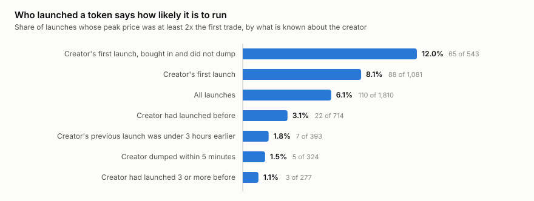
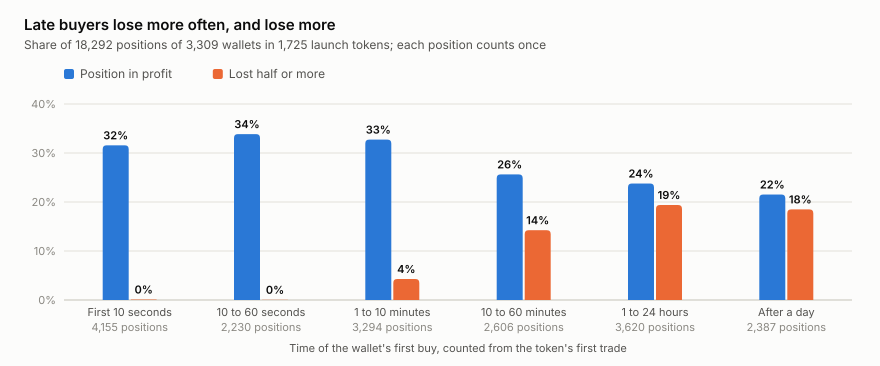

# Investment thesis: a NEAR memecoin is a ten-minute trade, and its odds are public at launch

*Snapshot of 12 November 2026. Every number below is in [thesis/data/numbers.md](thesis/data/numbers.md), produced by
`python thesis/build.py` from data collected by the indexer in this repository. Nothing here is investment advice.*

## The claim

**A token launched on a NEAR launchpad is not an asset to hold. It is a short trade, and the odds of that trade are
set by two facts anyone can read on-chain in its first minutes: who created the token and how early the buyer is.**

1. **Held, it loses.** Of 1,844 launches in 40 days, 6.1% ever doubled, 91% trade below their first price, and 1.0%
   still have a market a week later. The median launch token has three holders.
2. **The creator shifts the odds more than three-fold.** When it is the creator's first launch, the creator bought in
   and did not dump, 12.0% of launches doubled. For every other launch it is 3.5%. The gap is there in both halves of
   the window.
3. **The clock decides how bad it gets.** A position opened in the first ten minutes of trading is in profit about
   a third of the time and almost never loses half. One opened after the first hour is in profit less than a quarter
   of the time, and one in five loses half or more.
4. **Even the best case is a small edge, not a sure thing.** Early positions in launches that pass the creator test
   are in profit 41% of the time against 26% for other early positions — and the median one still loses 1.8%. The
   profit sits in a few large winners.

This is a thesis about one asset class — tokens of the Nearly and JustHoot launchpads on NEAR mainnet — and it is
stated with the limits of the data in view: one 40-day window, in a falling market.

We build tools for people who trade this market (the dashboard in this repository shows these facts live), so we
have a reason to want an edge to exist. The section "Evidence against the claim" is where we tried to break it.

## What was measured, and how to re-run it

The indexer in this repository reads NEAR mainnet blocks and writes trades, candles, launches, holders, wallet
flows and network metrics (the collections are described in [indexer/docs/DASH_DATA.md](indexer/docs/DASH_DATA.md)).
`thesis/build.py` turns them into an aggregate snapshot, the numbers table and the charts.

```bash
python thesis/build.py              # rebuilds charts and numbers from the committed snapshot; plain Python, no install
python thesis/build.py --collect    # recomputes the snapshot from your own indexer database (pip install pymongo)
```

The committed snapshot (`thesis/data/snapshot.json`) holds aggregates only, no wallet addresses. The same live data
is on https://dash.sendler.xyz and behind `https://api.sendler.xyz/v2/dash`. `--collect` needs a database with at
least 14 full days of trading and 100 launches; on a shorter one it says what is missing, saves what it collected
next to the snapshot and leaves the committed numbers alone.

Two units are used below. A **launch** is one token, counted once. A **position** is one wallet in one token:
everything that wallet bought and sold there, with what it still holds valued at the last traded price. Positions
are counted once each and not weighted by size, because a single token took 18% of all NEAR put into launches.

## Evidence for the claim

### 1. As an asset, a launched token fails

<picture>
  <source media="(prefers-color-scheme: dark)" srcset="thesis/charts/launch-outcomes-dark.svg">
  
</picture>

Of 1,844 launches, 98% got a trade, but the median launch saw 59 NEAR of volume in its whole life and peaked 3.5%
above its first price. 6.1% ever doubled, 0.9% went 10x, 3.6% reached a $10K market cap. 91% last traded below
their first price. Of 1,661 launches older than a week, 17 still have a market — at least three traders and 10 NEAR
of volume in the last three days. The median launch token has **3 holders**; 96% have ten or fewer.

Creators are part of the reason. In 17.8% of launches the creator sold at least half of their own tokens within
five minutes of trading (21% on Nearly, 9.5% on JustHoot). Of the 76 launches the indexer saw live with tax data,
26% were built so that the creator collects a transfer tax from bots while taking no position.

*Source: `launches` (dash_launches, dash_candles), `creators` (sniper_launch_stats), `holders` (dash_holder_stats).*

### 2. Who launched it shifts the odds

<picture>
  <source media="(prefers-color-scheme: dark)" srcset="thesis/charts/creator-record-dark.svg">
  
</picture>

Three facts about the creator are on-chain: whether this account has launched before, whether it took tokens of
its own launch, and whether it sold them at once. Launches where it is the creator's first launch, the creator
bought in and did not dump — 543 of the 1,810 that traded — doubled 12.0% of the time. The other 1,267 doubled
3.5% of the time. The same launches reached ten holders 9.5% of the time against 2.5%.

Repeat creators are the clearest warning. A creator who had launched before: 3.1% doubled. Three or more earlier
launches: 1.1%, and not one of those tokens reached ten holders. A previous launch less than three hours earlier:
1.8%.

The test was chosen on this data, so we cut the window in two at its median launch (18 October) and looked at each
half on its own:

| Launches that doubled | Before 18 October | From 18 October |
|---|---|---|
| Passed the creator test | 9.7% (37 of 382) | 17.4% (28 of 161) |
| Everything else | 4.0% (21 of 532) | 3.3% (24 of 735) |

The test keeps 30% of launches and with them 65 of the 110 that doubled, 11 of the 16 that went 10x, and seven of
the ten launches with the largest volume.

*Source: `edge.launches`, `edge.halves`, `edge.recall`.*

### 3. When the buyer came decides how bad it gets

<picture>
  <source media="(prefers-color-scheme: dark)" srcset="thesis/charts/entry-time-dark.svg">
  
</picture>

18,292 positions of 3,309 wallets, grouped by how long after the token's first trade the wallet first bought:

| First buy | Positions | In profit | Median result | Lost half or more |
|---|---|---|---|---|
| First 10 seconds | 4,155 | 31.6% | −1.9% | 0.1% |
| 10 to 60 seconds | 2,230 | 33.9% | −2.6% | 0.0% |
| 1 to 10 minutes | 3,294 | 32.7% | −4.2% | 4.3% |
| 10 to 60 minutes | 2,606 | 25.6% | −10.5% | 14.2% |
| 1 to 24 hours | 3,620 | 23.8% | −14.5% | 19.4% |
| After a day | 2,387 | 21.5% | −11.7% | 18.5% |

The line is at ten minutes. Before it the median position loses two to four percent — roughly the cost of getting
in and out — and a deep loss is rare. After it the median position loses 10 to 15 percent. The late buyer is the
early buyer's exit.

*Source: `edge.entry` (sniper_smart_flows, sniper_smart_prices).*

### 4. The two together

| Position opened | Launch passed the creator test | Everything else |
|---|---|---|
| In the first 10 minutes | 41.3% in profit, median −1.8%, mean +16.9% (3,936) | 26.4% in profit, median −2.3%, mean +2.1% (5,743) |
| 10 to 60 minutes | 25.1% in profit, median −10.8%, mean −3.6% (1,617) | 26.5% in profit, median −9.6%, mean −12.5% (989) |
| Later | 24.5% in profit, median −13.9%, mean −14.6% (4,412) | 18.4% in profit, median −11.0%, mean −18.8% (1,595) |

Only one cell is clearly ahead, and it needs both conditions. A good creator does not rescue a late entry: after
the first hour, positions in launches that passed the test lose about as much as any other. The early cell holds
in both halves of the window: 40.2% and 43.3% in profit for launches that passed, 30.5% and 23.3% for the rest.

*Source: `edge.entry_by_launch`, `edge.early_by_half`.*

### 5. A losing record carries over

We judged every wallet on the tokens it entered before a date and measured it on the tokens it entered after, for
three dates:

| Entries from | Wallets with a record of profit | With a record of loss | New wallets |
|---|---|---|---|
| 17 October | 35.5% in profit (332) | 17.5% (441) | 30.2% (2,183) |
| 21 October | 40.5% (294) | 21.9% (379) | 34.7% (1,656) |
| 26 October | 37.3% (228) | 26.7% (292) | 33.9% (1,166) |

A wallet that lost before is less likely to be in profit afterwards than a wallet nobody has seen. The result of a
wallet is a property of how it trades, not luck alone.

*Source: `edge.persistence`; a record is three or more tokens entered before the date.*

### 6. The market these trades live in

<picture>
  <source media="(prefers-color-scheme: dark)" srcset="thesis/charts/wallet-results-dark.svg">
  
</picture>

10,428 wallets bought a token for NEAR on a DEX between 29 September and 12 November and put in 5.12M NEAR. 30.2% of
them are in profit; the median wallet lost 0.80 NEAR. Winners made 570K NEAR, losers lost 602K; the top 1% of
wallets took 68% of all the profit.

<picture>
  <source media="(prefers-color-scheme: dark)" srcset="thesis/charts/activity-vs-price-dark.svg">
  
</picture>

The market is also shrinking. Unique DEX traders per day (7-day average) went from 114 in mid-August to 4,547 on
3 October and are at 664 now, 85% below the peak, while NEAR is 35% below its own peak. The weekly change in
traders correlates with the weekly change in price at 0.81 in the same week, 0.59 with the week before and 0.31
with the week after: trading follows the price, it does not lead it.

<picture>
  <source media="(prefers-color-scheme: dark)" srcset="thesis/charts/launches-per-week-dark.svg">
  
</picture>

Launches fell with it: from 63 a day in the week of 12 October to 17 a day in the week of 2 November.

<picture>
  <source media="(prefers-color-scheme: dark)" srcset="thesis/charts/dex-volume-dark.svg">
  
</picture>

Launchpad tokens made 59% of all DEX volume over the last 30 days, and five tokens made 51% of it. The chart counts
as launchpad tokens only launches recorded since 3 October, so before that date the orange part is understated.

*Source: `wallets`, `dex_daily`, `near_price`, `concentration`.*

## Evidence against the claim

- **The best case still loses at the median.** In the one cell that is ahead, the median position is −1.8%. The
  average is carried by the 3.1% of those positions that doubled. A trader who is not in those few tokens loses
  like everyone else, only more slowly. An average like that is also fragile: it rests on a handful of tokens in
  one window.
- **The first seconds belong to bots.** 4,155 positions were opened within ten seconds of the first trade, and a
  launch reaches its first trade a median 3.7 seconds after its first on-chain signal. A person arrives in the
  "1 to 10 minutes" row: 32.7% in profit, median −4.2%. The edge described here is mostly an edge for software.
- **Part of the creator test is known too late.** "Did not dump" is only known five minutes in, when half of the
  good window is gone. With what is known at the launch alone — the creator's first launch — the gap is 8.1%
  against 3.1%, not 12.0% against 3.5%.
- **A creator is an account, not a person.** Anyone can launch from a fresh account and pass as a first-time
  creator; 71% of the 1,090 creators here launched once. The test measures a window in which reusing an account
  marked spam. The more the test is used, the sooner it stops working.
- **Following winners is not supported.** Wallets with a record of profit were in profit afterwards 36–41% of the
  time, new wallets 30–35%. That gap is small next to the swing between dates. The data supports "a losing wallet
  keeps losing", not "copy a winning wallet".
- **The test was found on the data it is tested on.** It holds in both halves, but both halves are the same 40
  days of one falling market, and the second half has only 161 launches that pass.
- **The capacity is tiny.** The median launch trades 59 NEAR in its life. About 3,900 positions in 40 days met
  both conditions. This cannot absorb serious money, and whatever does absorb it changes the result.
- **It is close to zero-sum, not a rug.** Traders as a group lost 32K NEAR on 5.12M put in, under 1%. Money moved
  from many wallets to few. In 82% of launches the creator did not dump.
- **A few tokens do live.** 17 launches older than a week still have a market, 0.3% passed a $100K market cap, and
  the largest reached 110 holders. A power-law outcome is what an early market looks like; it is not proof that
  nothing here can become an asset.
- **The chain is not the limit.** NEAR processed about 930,000 transactions a day at a third of a cent each, with
  seconds from launch to first trade. Whatever keeps this market small, it is not cost or speed — so the first
  part of the claim could turn wrong quickly if demand arrives.

## What would change our mind

All thresholds are measured by `thesis/build.py` on the same collections, so anyone can check them later.

**"Not an asset" is wrong if, over the next 500 launches:**

| Metric today | Becomes |
|---|---|
| Launches older than a week that still have a market: 1.0% | reaches 10% |
| Median holders per launch token: 3 | reaches 20 |
| Launches whose last price is below the first: 91% | falls below 60% |

**"The odds are public" is wrong if, over the next 500 launches:**

| Metric today | Becomes |
|---|---|
| Doubled: passed the creator test 12.0%, everything else 3.5% | the first is less than 1.5 times the second |
| Early positions in profit: passed the test 41.3%, everything else 26.4% | the gap is under 5 points |
| Positions in profit: first 10 minutes 32–34%, after an hour 22–24% | the gap is under 5 points |
| Positions that lost half or more: after an hour 19% | falls below 5% |

Two of the four would be enough for us to stop treating the creator and the clock as signals.

**The claim gets stronger if** the gaps hold on the next 500 launches at the sizes above, and if wallets with a
record of loss stay under 25% in profit afterwards.

## What this data cannot say

- **It is one window.** 40 days of launches, all of them after the peak in traders. The filters describe this
  episode and may not repeat.
- **History before 9 November is reconstructed** from token transfers rather than observed live. It misses swaps
  settled from internal DEX balances (Intear) and counts transaction signers as traders. Creator tax data exists
  only for the 76 launches seen live.
- **Launch records before 17 October are stamped two hours early.** For 809 reconstructed launches the launch time
  is two hours before the token's first transfer; we checked a block against an archival RPC, and the trades are
  the ones stamped correctly. No measure here mixes the two clocks: the time of entry is counted from the token's
  first recorded trade, and the order of a creator's launches from launch records only.
- **16 launch records were left out.** Their token traded before the record's date: a pool created against an
  older token, not a launch. One of them carried half of all NEAR put into launch tokens and would have turned
  every size-weighted number.
- **"First launch" means first in the window.** Launches before 3 October are not recorded, so some creators
  counted as first-time are not.
- **Positions are marked at the last traded price.** For tokens that stopped trading the remainder is worth less
  than that, so shares in profit are, if anything, overstated. Results are per wallet, not per person; bots and
  people are not told apart.
- **"Still has a market" needs a definition.** A count of launches with any trade in the last three days moved
  from 6% to 26% within hours on 12 November, because one wallet sold dust in hundreds of dead tokens. The
  definition used here asks for three traders and 10 NEAR.
- **Three DEX venues are covered** — Rhea DCL, Rhea v1 and Intear. Network metrics cover two full days. The price
  series comes from REF Finance snapshots, not from an exchange feed.

## So what

For someone who trades NEAR memecoins, the reading is narrow and checkable. Do not hold them: one launch in a
hundred has a market a week later. If you trade them, the two things that matter are on-chain before you click —
whose launch it is and how many minutes it has been trading — and a late entry into a good launch is still a bad
trade. Size for the median, which is a small loss, not for the average. And a wallet that keeps losing should read
that as information.

For someone who holds NEAR, this market is not a reason to buy: it follows the price, it involves about 0.5% of
daily signers, and it is 85% below its peak. It is not a reason to sell either. The chain carries it for a third
of a cent per transaction with seconds of latency.

The dashboard this thesis is built on shows the creator's record, the creator's wallet and the age of every launch
as it happens, and keeps the numbers above live.
