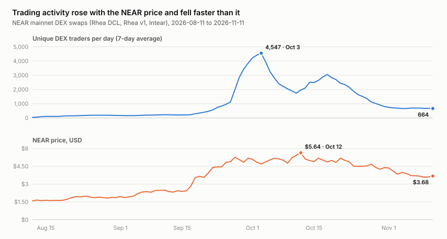
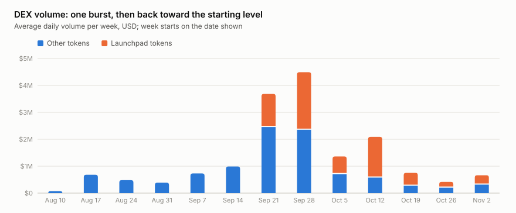
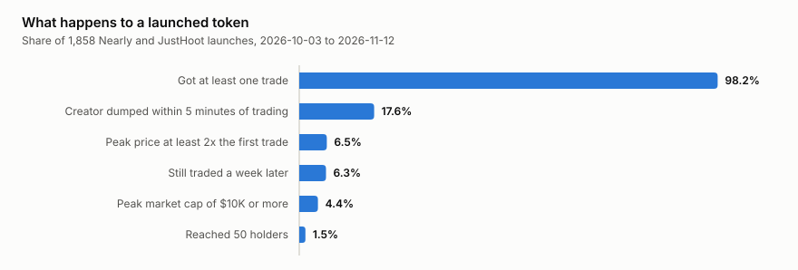
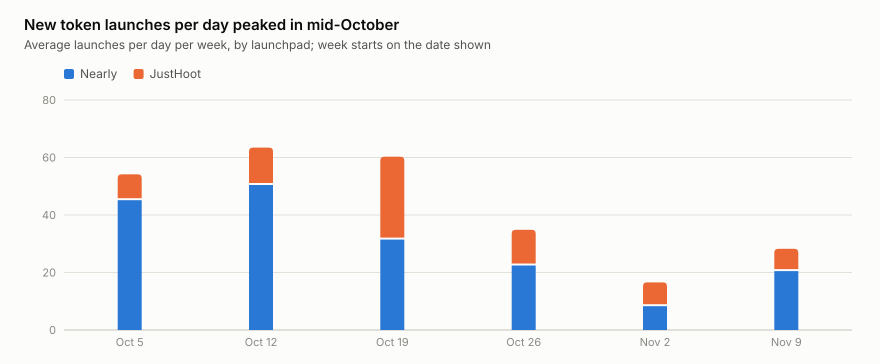
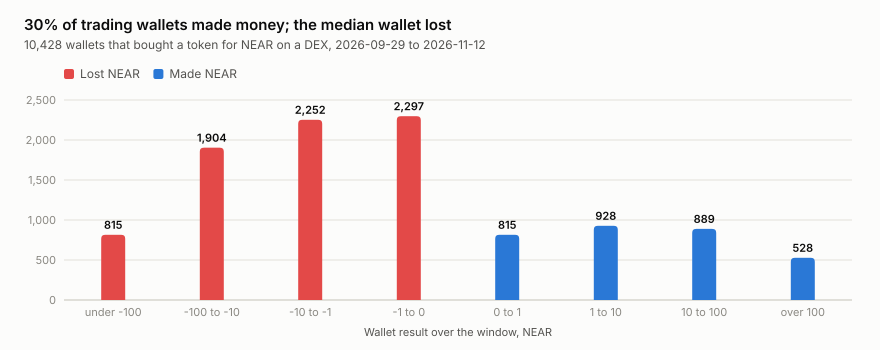

# Investment thesis: NEAR is ready for an on-chain trading economy it does not have yet

*Snapshot of 12 November 2026. Every number below is in [thesis/data/numbers.md](thesis/data/numbers.md), produced by
`python thesis/build.py` from data collected by the indexer in this repository. Nothing here is investment advice.*

## The claim

**Hold NEAR for what the chain can do, not for the trading activity on it today.**

1. The base layer already does the job a consumer trading economy needs: about 930,000 transactions a day at a
   third of a cent each, and a new token goes from its first on-chain signal to its first trade in a median 3.7
   seconds.
2. The trading economy that runs on it is not durable demand. Over three months it followed the NEAR price up and
   fell much further than the price did; six out of ten dollars of DEX volume go through launchpad tokens that
   typically end up with three holders; seven wallets in ten lose money.
3. So DEX and launchpad activity is not, today, a reason to buy NEAR, and it has not been a leading signal for the
   price. It becomes one only if it starts to hold up without the price. The section "What would change our mind"
   says exactly how that would look in these same metrics.

This is a thesis about one part of NEAR — its public trading and launch activity — and it is stated with the limits
of the data in view: 92 days of DEX history, 40 days of launches, two full days of network metrics.

## What was measured, and how to re-run it

The indexer in this repository reads NEAR mainnet blocks and writes trades, candles, launches, holders, wallet
flows and network metrics (the collections are described in [indexer/docs/DASH_DATA.md](indexer/docs/DASH_DATA.md)).
`thesis/build.py` turns them into an aggregate snapshot, the numbers table and the charts.

```bash
python thesis/build.py              # rebuilds charts and numbers from the committed snapshot; plain Python, no install
python thesis/build.py --collect    # recomputes the snapshot from your own indexer database (pip install pymongo)
```

The committed snapshot (`thesis/data/snapshot.json`) holds aggregates only, no wallet addresses. The same live data
is on https://dash.sendler.xyz and behind `https://api.sendler.xyz/v2/dash`.

## Evidence for the claim

### 1. Activity followed the price up, and fell twice as hard

<picture>
  <source media="(prefers-color-scheme: dark)" srcset="thesis/charts/activity-vs-price-dark.svg">
  
</picture>

Unique DEX traders per day (7-day average) went from 114 in mid-August to 4,547 on 3 October and are at 664 now:
85% below the peak. Over the same weeks NEAR went from $1.59 to $5.64 and is at $3.68: 35% below its peak. Daily
DEX volume fell by the same 85%, from $5.9M to $0.9M.

*Source: `dex_daily` (daily candles, unique wallets per day) and `near_price` (REF Finance snapshots).*

### 2. Traders did not move first

We tested whether trading activity leads the price. The weekly change in traders correlates with the weekly change
in price at 0.81 in the same week, at 0.59 with the price change of the week **before**, and at only 0.31 with the
price change of the week **after**. Activity moves with the price and after it, not ahead of it.

*Source: `derive.lead_lag` in `thesis/render.py`; 79 overlapping daily observations, one market cycle — indicative,
not a statistical proof.*

### 3. The volume is launchpad churn, concentrated in a few tokens

<picture>
  <source media="(prefers-color-scheme: dark)" srcset="thesis/charts/dex-volume-dark.svg">
  
</picture>

Over the last 30 days tokens of the Nearly, JustHoot and Intear launchpads made 59% of all DEX volume. One token made
21% of it, five made 51%, ten made 65% — out of 1,994 tokens traded. The chart counts as launchpad tokens only
launches recorded since 3 October, so before that date the orange part is understated.

*Source: `concentration` and `dex_daily`.*

### 4. A launched token almost never becomes an asset

<picture>
  <source media="(prefers-color-scheme: dark)" srcset="thesis/charts/launch-outcomes-dark.svg">
  
</picture>

Of 1,858 launches in 40 days, 98% got a trade, but the median launch saw 60 NEAR of volume in its whole life and
peaked 3.6% above its first price. 6.5% ever doubled, 0.9% went 10x, 4.4% reached a $10K market cap. Of launches
older than a week, 6% still traded in the last three days. The median launch token has **3 holders**; 95% have ten
or fewer; 1.5% reached fifty.

Creators do not help: in 17.6% of launches the creator sold at least half of his own tokens within five minutes of
trading (21% on Nearly, 9% on JustHoot), and of creators who received their own tokens, 72% sold some within the
first hour. Of the 74 launches the indexer saw live with tax data, 27% were built so that the creator collects a
transfer tax from bots while taking no position himself.

<picture>
  <source media="(prefers-color-scheme: dark)" srcset="thesis/charts/launches-per-week-dark.svg">
  
</picture>

Launches themselves slowed with the market: from 63 a day in the week of 12 October to 17 a day in the week of
2 November.

*Source: `launches` (dash_launches), `creators` (sniper_launch_stats), `holders` (dash_holder_stats).*

### 5. Most participants lose, and the winnings are concentrated

<picture>
  <source media="(prefers-color-scheme: dark)" srcset="thesis/charts/wallet-results-dark.svg">
  
</picture>

10,421 wallets bought a token for NEAR on a DEX between 29 September and 12 November and put in 5.09M NEAR. 29.9%
of them are in profit; the median wallet lost 0.83 NEAR. Winners made 560K NEAR in total, losers lost 608K; the top
1% of wallets took 68% of all the profit. Experience helps but does not fix it: of wallets that traded five or more
tokens, 39% are in profit.

*Source: `wallets` (sniper_smart_flows): the matched part of each position plus the remainder at the last traded
price — the formula the dashboard uses to rank smart money. Token creators in their own token and contracts are
excluded.*

## Evidence against the claim

The data also contains reasons to think the claim is too pessimistic. They are part of the thesis.

- **The chain did not get in the way.** During two full days measured, NEAR processed about 930,000 transactions
  and 4.4M receipts a day from roughly 129,000 unique signers, at $0.0035 per transaction. A launch reaches its first
  trade a median 3.7 seconds after its first on-chain signal (90th percentile 10.9 s). Whatever limits this economy,
  it is not cost or speed. *(`network`, `launch_speed`)*
- **DEX traders are a sliver of NEAR's users.** They are about 0.5% of daily signers. The collapse in trading says
  little about the other 99.5% — which this dataset does not classify. If those users are doing something durable,
  the claim about "activity" is a claim about a sideshow. *(`derive.traders_share_of_signers`)*
- **Serious value settles on NEAR regardless of memes.** Transfers of $1,000 or more ran at about $200M a day over
  68 hours — more than two hundred times the DEX volume: 64% in NEAR, 20% in bridged BTC, 9% in ZEC, 4% in
  stablecoins; 22% of it touched a bridge. *(`big_moves`; dollar values rely on REF prices and can be inflated for
  illiquid tokens, and exchange-internal shuffles are included)*
- **The floor is higher than the start.** 664 traders a day is 85% below the peak but almost six times the level of
  mid-August, and volume is about 1.7 times the late-August level. Some of the people who came, stayed.
- **The game is closer to zero-sum than to a rug.** Traders as a group lost 47K NEAR on 5.09M put in — under 1%.
  Money moved from many wallets to few; little of it left the table. And dumping is not the norm: in 82% of launches the
  creator did not dump, and the weekly dump rate fell from 27% at the end of October to 20% a week later.
- **A small number of tokens do live.** 105 launches older than a week still trade, 0.4% of launches passed a $100K
  market cap, and the largest reached 112 holders. A power-law outcome is what an early market looks like, not
  proof that there is no market.

## What would change our mind

All thresholds are measured by `thesis/build.py` on the same collections, so anyone can check them later.

**The claim is wrong — activity is durable demand — if, over any 30 days in which the NEAR price is flat or falling
(within ±10% or lower):**

| Metric today | Becomes |
|---|---|
| Unique DEX traders per day: 664 | holds above 1,500 |
| Median holders per launch token: 3 | reaches 20 |
| Launches older than 7 days still trading: 6% | reaches 20% |
| Wallets in profit: 29.9% | reaches 45% |
| Top 5 tokens' share of volume: 51% | falls below 35% |
| Traders vs next week's price (lead correlation): 0.31 | exceeds the same-week correlation |

Three of the six would be enough for us to treat on-chain trading as a real demand signal for NEAR.

**The other half of the claim is wrong — the base layer is not ready — if** the average fee per transaction rises
above $0.02 at this load, or the median time from launch signal to first trade rises above 15 seconds, or daily
transactions fall below 300,000 while the price holds.

**The claim gets stronger if** traders per day fall back below 300 (the level before the September move) while the
price stays above $3, or the creator dump rate returns above 25% for a month.

## What this data cannot say

- **It is one cycle.** 92 days of DEX history contain a single run-up and a single decline. The lead/lag result
  describes this episode and may not repeat.
- **Network metrics cover two full days** (10–11 November). There is no trend in transactions, signers or fees
  here, only a level. Daily signers are a HyperLogLog estimate and differed by a factor of two between the two days.
- **History before 9 November is reconstructed** from token transfers rather than observed live. It misses swaps
  settled from internal DEX balances (Intear) and round-trip arbitrage, and counts transaction signers as traders;
  the live stream counts the signer or the swap's actor. Trade *counts* are therefore not comparable across that
  date and are not used; trader and volume series are, with this caveat.
- **Launches before 3 October are not recorded**, so launch outcomes describe the weeks after the peak in traders,
  and creator tax data exists only for the 74 launches seen live.
- **Wallet results are marked at the last traded price.** For tokens that stopped trading the remainder may be
  worth less than that, so the 29.9% in profit is, if anything, an overstatement. Results are per wallet, not per
  person; bots and people are not told apart.
- **Three DEX venues are covered** — Rhea DCL, Rhea v1 and Intear. NEAR Intents volume, lending, staking and
  everything off these venues is outside the dataset; what the other 99.5% of signers do is unknown here.
- **The price series** comes from REF Finance snapshots, not from an exchange feed.

## So what

For an investor the practical reading is narrow and checkable. NEAR's public trading economy today is a bet on the
price with extra steps: it grows when NEAR rallies and shrinks faster when it stops, and most of the wallets that
play it lose a little to a few that win a lot. That is not a reason to sell — the chain carries it for a third of a
cent per transaction, with seconds of latency, next to roughly $200M a day of large transfers that have nothing to do
with memes. It is a reason not to count this activity as adoption until the table above says otherwise. The
dashboard this thesis is built on keeps those numbers live.
